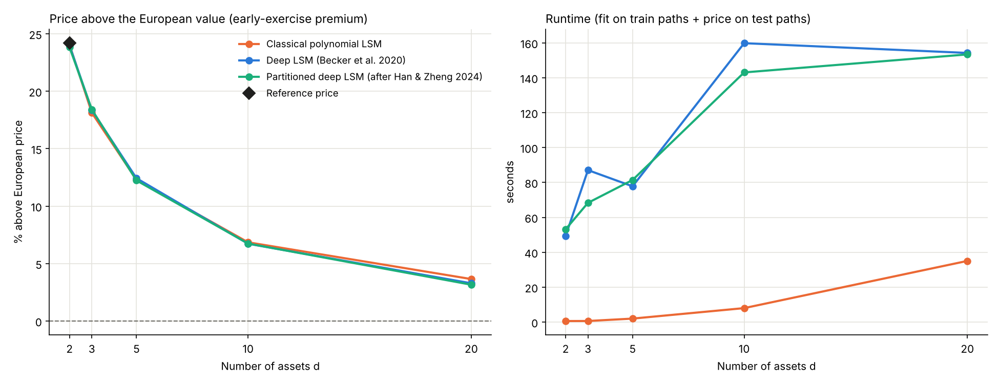

# Pricing High-Dimensional American Options with Deep Learning

Does deep learning actually price high-dimensional American options better than the classical approach? This project tests that on a Bermudan max-call option, comparing the classical **Longstaff–Schwartz (LSM)** algorithm with two **neural-network** versions of it as the number of underlying assets grows from 2 to 20.

Every price is checked against an independent reference: an exact lattice for two assets, and the European price, which is a lower bound in general and the exact answer when there are no dividends.

<p align="center">
  
</p>

## 1. The problem

An **American** option can be exercised at any time before maturity; a **Bermudan** option only on a fixed set of dates $t_1 < \dots < t_N = T$. The holder exercises when the immediate payoff is worth more than keeping the option alive, so the price is an **optimal stopping** problem:

$$
V_0 = \sup_{\tau \in \{t_1,\dots,t_N\}} \mathbb{E}^{\mathbb{Q}}\!\left[e^{-r\tau}\, g(S_\tau)\right].
$$

Here we price a **max-call** on $d$ assets, with payoff

$$
g(S) = \bigl(\max(S^1,\dots,S^d) - K\bigr)^+,
$$

where each asset follows a geometric Brownian motion under $\mathbb{Q}$ with dividend yield $q$.

Lattices and PDE grids need a number of points that grows exponentially with $d$, so beyond 2 or 3 assets the only practical tool is Monte Carlo simulation. Monte Carlo alone is not enough, though: at every exercise date we must decide whether to stop, and that requires the **continuation value**

$$
C_n(s) = \mathbb{E}^{\mathbb{Q}}\!\left[e^{-r(t_{n+1}-t_n)}\, V_{n+1} \,\middle|\, S_{t_n} = s\right].
$$

## 2. Methods

All three methods use the same backward induction (Longstaff & Schwartz, 2001). They differ only in how they estimate $C_n$ from the simulated paths.

1. Simulate paths of the $d$ assets.
2. At maturity, every path's cash flow is its payoff.
3. Going backwards over the exercise dates, regress the discounted future cash flows on the current asset prices, using in-the-money paths only. Wherever the immediate payoff exceeds the fitted continuation value, exercise: that path's cash flow becomes the immediate payoff.
4. The price is the average discounted cash flow.

| Method | Continuation value $C_n(s)$ |
|---|---|
| **Classical LSM** | Least-squares fit on polynomials of degree 2 in $s/K$ (constant, linear, squared and cross terms): $1 + 2d + d(d-1)/2$ features |
| **Deep LSM** (Becker, Cheridito & Jentzen, 2020) | One feed-forward network per exercise date: two hidden layers of 32 ReLU units, trained with Adam on the mean squared error |
| **Partitioned deep LSM** (after Han & Zheng, 2024) | The state space is split into two regions, $\max_i s^i \le 1.15K$ and $> 1.15K$, with a separate network in each. This is a simplified two-region version of the idea. The paper partitions the state space into bundles and learns the stopping decision in each, whereas here each network regresses the continuation value. |

**Implementation details.**

| | |
|---|---|
| Simulation | Exact GBM steps between exercise dates (Cholesky factor for correlated assets), float32 |
| Regression data | In-the-money paths only; inputs and targets divided by $K$ |
| Networks | 2 hidden layers × 32 units, batch normalisation after the first layer, ReLU |
| Training | Full-batch Adam, learning rate $10^{-2}$, 300 epochs; a fresh network at every exercise date |
| Paths | 100,000 for fitting, 100,000 independent paths for pricing |
| Reproducibility | Fixed seeds for paths and network initialisation |

**Out-of-sample pricing.** The exercise rule is fitted on 100,000 *training* paths and then applied to 100,000 independent *test* paths. Pricing on the training paths would be biased upwards, because the regression partly fits their noise. On fresh paths, the estimate is the value of a real (slightly suboptimal) exercise strategy, so it is a **lower bound** for the true price. A higher price therefore means a better exercise rule.

## 3. Results

Setup: $S_0 = K = 100$, $r = 5\%$, $q = 10\%$, $\sigma = 20\%$, independent assets ($\rho = 0$), $T = 3$ years, 9 exercise dates. This is the standard Bermudan max-call benchmark from the literature. Output of `python multi_asset_option_pricer.py`:

| d | European | Reference | Classical LSM | Deep LSM | Partitioned deep LSM |
|---|---|---|---|---|---|
| 2 | 11.194 | **13.901** | 13.886 ± 0.047 | 13.879 ± 0.047 | 13.861 ± 0.048 |
| 3 | 15.671 | | 18.511 ± 0.052 | 18.548 ± 0.055 | 18.556 ± 0.055 |
| 5 | 23.042 | | 25.875 ± 0.058 | 25.906 ± 0.062 | 25.862 ± 0.062 |
| 10 | 35.566 | | 38.003 ± 0.063 | 37.959 ± 0.066 | 37.965 ± 0.066 |
| 20 | 49.447 | | 51.254 ± 0.065 | 51.072 ± 0.065 | 51.011 ± 0.066 |

± is the Monte Carlo standard error. The **European** price (2 million paths) is a lower bound for every Bermudan price. The **reference** for $d = 2$ comes from a 2-D binomial lattice with 1,800 time steps; no comparable exact method exists for larger $d$.

**What the results show:**

* **All three methods work.** For two assets they agree with the lattice reference to within one standard error. For every $d$ they find an early-exercise premium of between about 3% and 24% over the European price.
* **On this benchmark, deep learning gives no accuracy advantage up to 20 assets.** For $d \le 10$ the three methods agree within Monte Carlo error. At $d = 20$, classical LSM is slightly but consistently ahead.
  * To check that this is not a fluke of one run, I repeated $d = 2$ and $d = 20$ three more times with different seeds for both the paths and the networks.
  * At $d = 20$, LSM beat deep LSM in all four runs, by 0.10 to 0.18, and beat the partitioned version by 0.24 to 0.32.
  * At $d = 2$ the differences were below 0.03 and changed sign between runs, i.e. they are noise.
* **Classical LSM is much faster:** roughly 4× at $d = 20$ and over 50× for $d \le 5$. It solves one least-squares problem per date, while the networks are trained by gradient descent.
* **Classical LSM shows no numerical breakdown.** With features scaled by $K$, the largest condition number of the regression matrix at $d = 20$ is about $2\times10^4$, and its 231 features are few compared with 100,000 paths. Polynomial regression does run into trouble eventually, because the number of features grows like $d^2$ (or faster for higher degrees). That is where neural networks are expected to pay off, at dimensions well beyond 20.

### Sanity check: without dividends

Without dividends ($q = 0$), it is never optimal to exercise an American max-call early, so its price equals the European price. The reason: each discounted price $e^{-rt}S^i_t$ is a martingale, so $\max_i e^{-rt}S^i_t - e^{-rt}K$ is a submartingale. Its positive part, the discounted payoff, is then a submartingale too, which means waiting never lowers its expected value. Every method should therefore recover the European value and find no early-exercise premium. Output of `python multi_asset_option_pricer.py --no-dividend`:

| d | European (= true price) | Classical LSM | Deep LSM | Partitioned deep LSM |
|---|---|---|---|---|
| 2 | **34.989** | 34.051 ± 0.095 | 35.120 ± 0.106 | 35.119 ± 0.106 |
| 3 | **45.057** | 43.900 ± 0.097 | 45.010 ± 0.108 | 45.030 ± 0.108 |
| 5 | **58.787** | 57.532 ± 0.098 | 58.720 ± 0.108 | 58.648 ± 0.108 |
| 10 | **77.826** | 76.395 ± 0.096 | 77.002 ± 0.101 | 76.797 ± 0.100 |
| 20 | **96.852** | 95.210 ± 0.094 | 95.131 ± 0.095 | 95.103 ± 0.094 |

This case turns out to be a useful test in its own right. The correct rule here is "never exercise early", and any early exercise loses money:

* **Up to 5 assets, the networks learn this rule.** Their prices match the true value within Monte Carlo error.
* **Classical LSM exercises too often**, losing between 1.7% and 2.7% of the value at every dimension. A quadratic polynomial cannot represent the continuation value accurately enough, so on some paths it wrongly finds that exercising pays.
* **At 10 and 20 assets the networks lose about 1–2% too.** At $d = 20$ all three methods are equally far off.

So the two benchmarks give a more nuanced picture than "deep learning wins". On the standard dividend benchmark, classical LSM is just as accurate and much faster. When the continuation value is harder to approximate with a quadratic polynomial, the networks are clearly more accurate in low dimensions.

## 4. Running

```bash
pip install -r requirements.txt
python multi_asset_option_pricer.py                # main benchmark, about 20 min on a laptop CPU
python multi_asset_option_pricer.py --no-dividend  # sanity check
```

Each run prints the results table and writes a static figure (`docs/benchmark.png`) and an interactive version (`docs/interactive_benchmark.html`). The `--no-dividend` run writes the same files with a `_no_dividend` suffix.

```
multi_asset_option_pricer.py   simulation, the three pricers, reference prices, benchmark, figures
seed_variability.py            repeats d = 2 and d = 20 with different seeds (about 20 min)
docs/                          figures produced by the two runs
requirements.txt
```

## 5. Pitfalls this benchmark guards against

Each of these was found by checking prices against the references above, and each one changes the conclusions:

* **A test case with no early-exercise premium.** Without dividends the American max-call equals its European counterpart. A benchmark built on it cannot show any method doing better; it can only show which methods lose value by exercising too early.
* **Unscaled inputs.** Networks fed raw prices around 100, with only a few dozen training steps, barely learn anything. They predict a continuation value near zero, exercise almost immediately, and come out 20–45% below the true price. Scaling inputs and targets by $K$ fixes this.
* **Pricing on the training paths.** This biases the price upwards. In a test at $d = 2$ with 10,000 paths, a network priced on its own training paths returned 14.29, above the exact 13.90.
* **Discounting only the in-the-money paths.** Every path's cash flow must be discounted at every step, not only the paths used in the regression. Getting this wrong inflates prices slightly.
* **Ill-conditioning from unscaled polynomial features.** With raw prices, the squared terms are around $10^4$ and the condition number rises to about $10^8$. Scaling by $K$ brings it down to about $10^4$. Even unscaled, the least-squares solve never failed up to $d = 20$.

## 6. Limitations and next steps

* **No upper bounds.** Out-of-sample prices are lower bounds, so for $d \ge 3$ the gap to the true price is unknown. A dual (upper-bound) estimate, as in Andersen & Broadie (2004) or Becker et al. (2020), would bracket it.
* **One option and one model.** Only a symmetric max-call under Black–Scholes is tested. Basket or rainbow payoffs and stochastic volatility would test the methods more broadly.
* **Small, untuned networks.** Larger networks, sorted asset prices as inputs, or warm-starting each network from the previous date could help. So are higher-degree or payoff-based features for LSM.
* **CPU only.** Runtimes are for a single CPU with full-batch training. On a GPU the gap to LSM would be smaller.

## References

* Andersen, L., & Broadie, M. (2004). Primal-dual simulation algorithm for pricing multidimensional American options. *Management Science*, 50(9), 1222–1234.
* Longstaff, F. A., & Schwartz, E. S. (2001). Valuing American options by simulation: a simple least-squares approach. *The Review of Financial Studies*, 14(1), 113–147.
* Becker, S., Cheridito, P., & Jentzen, A. (2020). Pricing and hedging American-style options with deep learning. *Journal of Risk and Financial Management*, 13(7), 158.
* Han, Y., & Zheng, X. (2024). A deep learning method for pricing high-dimensional American-style options via state-space partition. *Computational and Applied Mathematics*, 43, 152.
* Glasserman, P. (2003). *Monte Carlo Methods in Financial Engineering*. Springer.

## License

MIT, see [LICENSE](LICENSE).
